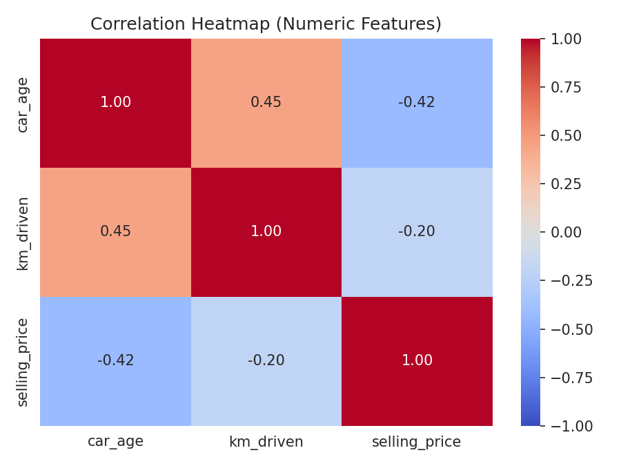
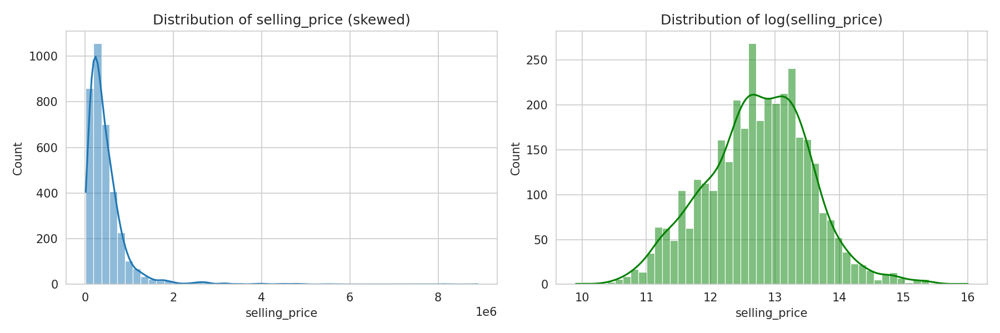
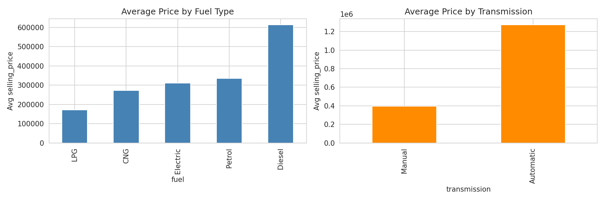
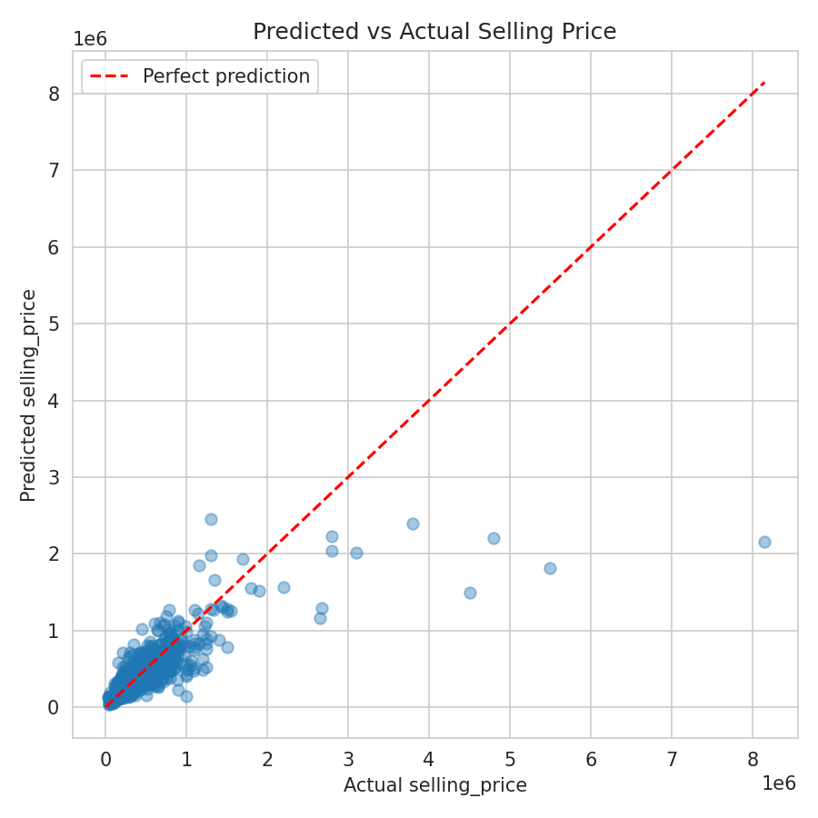

# Car Price Prediction

## Problem Statement
A used-car marketplace wants to help sellers price their vehicles fairly based on the car's age, mileage, fuel type, and other listing details. The business objective is to predict the resale price of a used car from its specifications so that sellers get realistic price suggestions and buyers can spot overpriced listings. As an additional requirement, a correlation analysis between the numeric features (car_age, km_driven, selling_price) was performed before training the model.

## Dataset
- **Name:** Vehicle Dataset from CarDekho
- **Source:** Kaggle (nehalbirla)
- **Link:** https://www.kaggle.com/datasets/nehalbirla/vehicle-dataset-from-cardekho
- **Rows / Columns:** 4340 rows, 8 columns (name, year, selling_price, km_driven, fuel, seller_type, transmission, owner); 3577 rows after removing 763 duplicate listings

## Tools Used
- Python
- Pandas, NumPy
- Matplotlib, Seaborn
- Scikit-learn

## Workflow
1. Data Collection
2. Data Cleaning
3. Exploratory Data Analysis (EDA)
4. Feature Engineering
5. Model Building (Linear Regression)
6. Evaluation
7. Insights & Recommendations

## Results
- **Model:** Linear Regression (target log-transformed, predictions converted back to price)
- **Key Metric(s):** R2 = 0.5765 on the price scale (0.7652 on the log-price scale), MAE ≈ 153,733, RMSE ≈ 369,340
- **Top Factors / Drivers:**
  - **car_age** (correlation with selling_price = -0.42): older cars sell for less because of depreciation; it is the strongest numeric driver.
  - **km_driven** (correlation with selling_price = -0.20): higher mileage means more wear, so the price drops, but the effect is weaker than age.
  - **transmission / fuel / brand:** automatic cars, diesel cars and premium brands such as Audi have much higher average prices.

## Screenshots

## Future Improvements
- Try a Random Forest and compare performance
- Add more features such as city, car model variant and service history
- Deploy the model as a simple web app for sellers

## Author
Neelam Kumari
